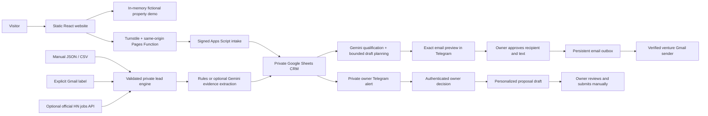

# Architecture and decisions

The public React experience shares typed validation with a Cloudflare Pages intake Function. Automation runs in a bound Google Apps Script project with private Google Sheets as the source of truth. Server-side signing secrets never enter the browser. Only consented website enquiries can enter the approved-email path; discovered opportunities remain manual submissions.

## Code ownership

| Location | Responsibility |
|---|---|
| `apps/web` | React/TypeScript/Vite/Tailwind agency pages, accessible native form controls, fictional demo |
| `packages/core/model.ts` | Strict input/config schemas, statuses, types, stable IDs and contact checks |
| `packages/core/scoring.ts` | Source cleaning, injection heuristic, structured extraction schema, transparent scoring |
| `packages/core/qualification.ts` | Discovery-specific source/safety, buyer, engagement, payment, scope gates, evidence audit and policy versions |
| `packages/core/workflow.ts` | Ingestion, transitions, approvals, crash reconciliation, drafts, owner commands |
| `packages/core/csv.ts` | Bounded CSV parser, template migration mapping, formula-safe export |
| `apps/automation/adapters.ts` | Testable Gmail, Gemini and official HN wire formats |
| `apps/automation/sheets.ts` | Stable-header tables and ID-based writes; no row-index identity |
| `apps/automation/main.ts` | Google APIs, script locks, schedule, budgets, UI actions and Telegram polling |
| `scripts/cli.ts` | Fully offline private workflow with local JSON persistence |
| `tests` | Core/adapters/Apps Script mocked runtime and desktop/mobile browser checks |

## Chosen tradeoffs

**One repository, simple scripts.** No monorepo framework or large UI toolkit. esbuild bundles the actual shared TypeScript into Apps Script; no manually duplicated scoring implementation. The UI uses local system fonts, CSS and Lucide SVG icons. No stock-photo or paid asset dependency.

**Rules are a supported operating mode.** Gemini extracts exact evidence for hiring intent, supported skills and timeline. Strict JSON rejects extra fields or unsupported quotations. The application calculates points and retains unknown budgets/identity as unknown. Supplied budget fields are owner/source facts; currency conversion is not guessed. The proposal template uses those facts and explicit assumptions without making model calls.

**Separate qualification contexts.** Inbound enquiry scoring/drafting remains consent-based and is not controlled by the discovery setting. HN discovery uses versioned buyer/independent-engagement/paid-intent/scope gates; explicit seller and employment exclusions precede incomplete-data holds. `FREELANCE_QUALIFICATION_MODE` defaults to `shadow` and suppresses discovery notices; `enforce` routes only eligible MEDIUM/HIGH records. Scores are not conversion probabilities.

**Credentials stay on servers.** The browser only gets public site/contact/Turnstile settings. Cloudflare stores the Turnstile secret and shared HMAC; Apps Script stores that HMAC plus provider keys. The anonymous Apps Script web app validates signed POSTs and exposes only a generic GET health response. It cannot be used as a public CRM reader or arbitrary mail sender.

**Polling with explicit limits.** A single 10-minute trigger polls Telegram and checks whether the source interval has elapsed (60 minutes by default). Source batch size defaults to 5. A soft 45-second execution budget, daily run/HTTP/model budgets and script lock prevent overlapping/unbounded work. Google calls may exceed the soft budget while in flight; the next iteration stops. The provider's hard runtime and daily quotas still apply.

**Delivery is conservative.** Requests use random server-side nonces, private owner user/chat IDs, message origin and expiry. A persisted decision is reconciled after interruption. New alerts move PREPARED → SENDING → SENT. A timeout or uncertain send becomes FAILED and needs manual review/renewal; Telegram send methods do not offer an idempotency key, so automatic retransmission could duplicate a message. Command replies advance the update cursor before delivery; if the response is lost the owner can repeat the command. The Sheet remains authoritative.

**Sheets is not a transactional database.** A script lock serializes app writers. Approval/ingest reconciliation covers expected interruption points and immutable IDs prevent ordinary duplicates. A hard failure between a row update and its audit append can require manual reconciliation; spreadsheet edits by other users can bypass application rules. Restrict sharing, take backups and migrate to transactional storage before multiple operators or high volume. Generated lead columns are not an editable admin API.

## Deliberately deferred

No public private-dashboard authentication surface, unattended outreach, platform scraping, auto-bidding, calls, payments, contracts, reply monitoring or SaaS tenant separation. Freelancer OAuth is a named disabled extension. Zoho, maintenance reminders, Cal booking integration, voice and n8n are later work, not hidden unfinished dependencies of P0.
