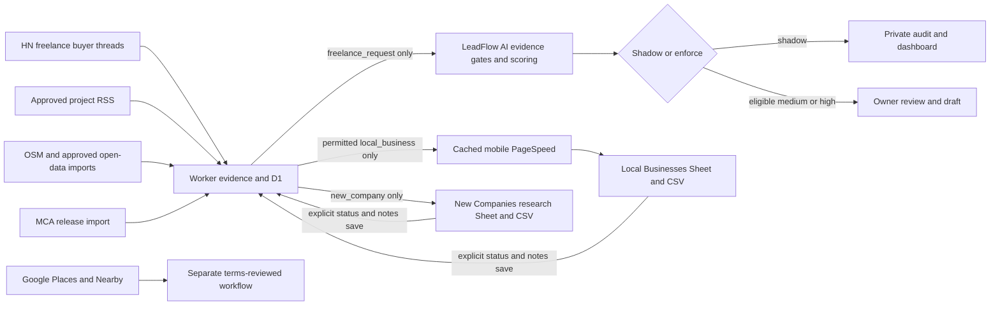

# LeadFlow source expansion blueprint for Copilot

21 November 2026 · Design only · `leadflow-leads` `feature-new-sources-aa` at `71d0a5a` and `leadflow-ai` `main` at `8463503`.

## 1. Baseline and implementation priorities

| Checked implementation | Consequence for this expansion |
|---|---|
| Worker `src/collect.ts` has HN, job boards, OSM and Google adapters. Foursquare commercial and HERE are disabled stubs. Default HN mode looks for top-level buyer headers. `runDaily` still includes job boards and configured Google calls. | Keep job boards as research inventory. Introduce an explicit daily source policy. Buyer scarcity is a source coverage issue and does not justify weaker qualification. |
| `src/index.ts` and `src/import.ts` already accept canonical Overture, FSQ OS and MCA JSON. `0001_init.sql` has no source evidence, registration fields or PageSpeed timestamp. The current CSV exporter excludes Google but only exports `local_business`. | Extend the existing routes and add migrations. Build offline converters. Do not replace the API or ask the Worker to download GeoParquet. |
| `src/db.ts` updates by `(source, source_id)` but drops conflicting cross-source rows. Domain and phone can collapse branches. `upsertLeads` counts by source before and after writes, so parallel same-source runs can distort metrics. | Preserve stable D1 row IDs and manual status. Add source observations and conservative entity matching. Count per write inside the transaction. |
| `src/enrich/pagespeed.ts` tests unscored local websites in parallel, stores `-1` for many errors and has no refresh schedule. | Separate measurement failures from site quality. Cache by tested URL and add a repeatable quota and retry policy. |
| `leadflow-ai` already has `freelance.v2` qualification, shadow/enforce, deterministic review gating and Gemini/OpenAI-compatible extraction with rules fallback. `external-leads.ts` builds evidence only for HN, and `qualification.ts` allows only `hackernews`. | Add an evidence mapping for approved feeds and update the shared source gate. Never let a new RSS row fall back to the legacy `csv` assessment path. |
| GAS `syncLocalBusinessProspects` and `saveSelectedLocalBusinessFollowup` operate on the separate Local Businesses tab. The dashboard and Vite local middleware already exist. | Extend manual queue support for `new_company` through a separate filtered tab/export. Reuse the existing dashboard and provider controls. |

The supplied source PDF is a catalog and an earlier design, not a statement of what is currently shipped. The current audit, tests and checked-out code take precedence. The budgets below are **application defaults**, not provider entitlements or price guarantees.

Checked artifacts include the source PDF, producer audit and workflow notes, Worker routes/adapters/schema/tests, and the consumer handoffs, workflow notes, qualification, manual sync, local runner and dashboard contracts. The branch's recorded test results are baseline references. This blueprint does not claim a fresh runtime or deployment verification.



## 2. Source activation and operating boundaries

| Source | Initial decision and evidence |
|---|---|
| WordPress Jobs RSS | `https://jobs.wordpress.net/feed/` returned HTTP 200 and ten RSS items on 21 November. The feed includes title, link, GUID, date, description, encoded content and a post ID. It is a job board, so a feed entry alone proves neither independent engagement nor payment. Use brief evidence and a link back under the approved retention/use policy. If a feed has excerpts only, hold ambiguous rows. [Feed](https://jobs.wordpress.net/feed/) · [Publisher FAQ](https://jobs.wordpress.net/faq/) |
| Freelancer.com RSS | Reserve `freelancer_rss` as a disabled adapter. No current authorized project feed URL was verified. Section 33 requires express written permission for automated access. Activate only after the owner records permission covering the exact feed URLs, use, polling limits and retention. The general and skill-specific URL list is owner configuration. Do not guess historical endpoints or substitute page scraping. The pipeline proceeds with HN and approved WordPress Jobs if Freelancer stays disabled. [Freelancer User Agreement](https://www.freelancer.com/about/terms) |
| Overture / FSQ OS | Pin the download release and preserve its provided licenses and notices. Overture Places can include FSQ-derived features. Preserve per-source attribution and identity references for matching. The FSQ open dataset and its paid API are separate. [Overture Places guide](https://docs.overturemaps.org/guides/places/) · [Overture attribution](https://docs.overturemaps.org/attribution/) · [FSQ OS schema](https://docs.foursquare.com/data-products/docs/places-os-data-schema) |
| OSM | Retain ODbL attribution on its rows and relevant exports. A conflated database may acquire ODbL obligations. Initial matching keeps OSM data in separate observations, without copying OSM attributes into open-data export rows. Obtain an explicit licensing decision before distributing a conflated dataset. [OSM copyright and license](https://www.openstreetmap.org/copyright) |
| Google Places/Nearby | Gate collection **before** `runSource` persistence and before cron dispatch. Leave `GOOGLE_PLACES_PROSPECTING_ENABLED` absent from config and keep the existing adapters available only for a separately approved, compatible workflow. The current code stores full results even though exporters exclude them. Disable those collection routes for this rollout, exclude existing rows from matching, enrichment and export, and inventory existing stored content for a separately authorized retention review. A place ID exception does not authorize a prospect database. A PageSpeed key must never activate Places. [Places API policies](https://developers.google.com/maps/documentation/places/web-service/policies) |
| MCA | Pin an actual released file and its terms in a manifest. The government [Company Master Data catalog](https://data.gov.in/catalog/company-master-data) establishes CIN and registration fields. Availability of a specific monthly Pune file, NIC, addresses and contact columns varies by release. The converter must accept explicit column bindings and fail if required columns are absent. Do not infer a recurring download URL. |

No collection adapter sends messages. `new_company` represents a registration record and carries no buying-intent claim. `company_hiring` remains queryable outside the qualified freelance alert stream. Keyed paid providers and billing activation are outside the default rollout.

Worker configuration for Copilot: `DAILY_FREELANCE_SOURCES=hackernews`, `WORDPRESS_JOBS_RSS_ENABLED=false`, `FREELANCER_RSS_ENABLED=false`, `FREELANCER_RSS_FEEDS_JSON=[]`, `PAGESPEED_ENABLED=false`, `PAGESPEED_DAILY_LIMIT` unset (derived from the key policy), `DAILY_SEARCHES=""`, `DAILY_NEARBY=""`. Accept only literal `true` for switches. Keep keys in ignored `.dev.vars` or Worker secrets. `FREELANCER_RSS_FEEDS_JSON` is a configured array of `{feedId,url,rightsReference}` with unique IDs and max four entries. `DAILY_FREELANCE_SOURCES` accepts the three buyer adapter IDs only. Publish configuration errors in readiness without making provider calls. After a permitted WordPress trial, add `wordpress_jobs_rss` to both the Worker schedule and the consumer's `EXTERNAL_LEADS_SOURCES` explicitly.

## 3. Worker contracts and migration

Add a numbered migration after `0001_init.sql`. Never reset local D1 or edit the applied migration. Old rows stay readable. Use these additive columns on `leads`, nullable unless noted:

| Column | Value and storage contract |
|---|---|
| `listing_evidence_json TEXT` | Serialized `ListingEvidenceV1` below. Only freelance source evidence. |
| `published_at TEXT`, `last_seen_at TEXT` | Original publication UTC and last successful observation UTC. Initialize `last_seen_at=updated_at` for existing rows. Keep first `found_at` immutable. |
| `registered_on TEXT`, `activity_code TEXT`, `activity_label TEXT` | MCA ISO calendar date, optional NIC string and source-stated activity. Legacy `registered:` tag is read fallback until a validated replay. |
| `pagespeed_checked_at TEXT`, `pagespeed_url_key TEXT` | Successful observation timestamp and normalized tested URL key. An old score lacking either is due for recheck. |
| `queue_revision INTEGER NOT NULL DEFAULT 0` | Increment only on explicit status/notes changes. Collection and enrichment preserve it. |

```ts
interface ListingEvidenceV1 {
  version: 1;
  original_title: string; // <=300 UTF-16 units
  original_url: string; // HTTPS, <=2000, source-specific host
  raw_text: string; // source-permitted HTML/text, <=20000
  decoded_text: string; // paragraph-preserving, <=12000
  published_at: string | null; // ISO UTC, never fetch time
  observed_at: string; // ISO UTC
  link_targets: string[]; // <=10 HTTP(S) source-stated hrefs
  content_hash: string; // SHA-256 hex
  complete: boolean;
  truncated: boolean;
}
```

Use `crypto.subtle.digest` in the Worker. Hash a fixed-order array `[original_title, normalizedOriginalUrl, raw_text, published_at, complete, truncated]` as JSON UTF-8. `observed_at` is excluded. Preserve exact text and the cap indicators. A malformed optional date is null and counted as a warning. Storage/evidence of content beyond approved rights is limited to link/allowed excerpt with `complete=false`.

Add these tables, with primary keys and indexes as stated:

- `source_observations(source, source_id, lead_id, release_id, source_ref, license_id, observed_at, canonical_json)` with PK `(source, source_id)`, FK to leads and index `lead_id`. Holds permitted open-data source fields and normalized identity. Cap `canonical_json` to 8 KiB plus archive provenance manifest outside D1. Never add a Google observation. Persist original source aliases, not just winner rows.
- `pipeline_source_state(key PRIMARY KEY, etag, last_modified, failure_count, next_due_at, last_success_at, lease_id, lease_until)` for each feed and source circuit. Conditional `UPDATE ... WHERE ...` only if due and lease expired. Late writers must match lease_id. Feed validators and success state advance only after all writes are committed.
- `pagespeed_cache(url_key PRIMARY KEY, state, score, lcp_ms, tbt_ms, cls, tested_at, next_due_at, attempts, error_code, lease_id, lease_until)` and `pipeline_daily_usage(day_utc, bucket, attempts, PRIMARY KEY(day_utc,bucket))`. An atomic conditional increment reserves each call before fetch. On budget exhausted/process crash, do not assume unused credits are refundable.

`GET /leads` preserves current response fields. Parse/clamp integer `limit` to 1–200 and `offset` to ≥0. Add `category=freelance_request` with comma-separated `sources=` (allowlisted exact IDs, 1–8, intersect with singular `source` if both present). Optional `include=evidence` restricted to authenticated freelance pull, max `limit=5`. Default lists and CSV omit evidence. Project `listing_evidence` as a validated object or null. Add cursor pagination for buyer pulls with `after_id`, `until_id` and `order=asc`, ordered by `id`. Bind filters and IDs. On first page return filtered `snapshot_until_id=max(id)` or the incoming `after_id` on empty inventory, `next_after_id=last returned id` or the incoming `after_id` when empty, and `has_more` (peek one row). Constrain subsequent pages to `id > after_id AND id <= until_id`. Reject malformed/conflicting paging parameters (400), keep offset contract for legacy clients. Identical replay must preserve IDs.

Example request: `GET /leads?category=freelance_request&sources=hackernews,wordpress_jobs_rss&include=evidence&after_id=0&order=asc&limit=5`. The response keeps `{ok,total,count,limit,leads}` and returns `{offset:0,snapshot_until_id,next_after_id,has_more}`. `total` in cursor mode counts matching rows inside the upper snapshot bound before applying `after_id`. On completion persist `snapshot_until_id` as the durable lower bound, then start a fresh snapshot on the next tick. An empty page advances only through its valid snapshot bound. Old HN records without `listing_evidence` continue to use official Firebase item/parent reads. Never use RSS excerpts as replacement evidence for HN.

**Change tracking.** The ID cursor is an insertion cursor. Existing source edits refresh evidence for the same ID and must not be mistaken for new leads. Add a bounded owner-only revision scan with `updated_since` (UTC window, ordered by `(updated_at,id)`), or explicit selected-record refresh for first release. Record differing `content_hash` and review through notification-suppressed requalification. Until the revision scan ships, schedule no automatic re-notification of edited listings. Do not update `updated_at` on an identical refresh. Advance normal consumer checkpoints after private persistence only and protect cursor with the existing Apps Script lock or local runner lock. Namespace checkpoint by API origin + sorted source set + evidence version so changes do not skip rows. Do not reuse a checkpoint across rebuilt databases. On cutover use a 30-day bounded backfill with existing dedup and a fixed snapshot, then advance from it.

## 4. Project RSS implementation

Proposed files `src/adapters/projectRss.ts`, `src/feeds/rss.ts`. `parseRss(xml: string, policy: FeedPolicy): RssItem[]`, `mapProjectItem(item: RssItem, policy: FeedPolicy, now: Date): Lead | null`, `collectProjectFeed(env: Env, policy: FeedPolicy, limit: number): Promise<Lead[]>`. `FeedPolicy` contains `source`, fixed `feedId`, feed URL, exact allowed redirect/item hosts, `rightsReference`, allowed content grade, and `minimumPollMinutes`. `RssItem` fields `title`, `link`, `guid`, `pubDate`, `description`, `contentEncoded`, `postId` are optional strings parsed from **direct** RSS `channel/item` children. `title` and canonical link are required for a lead. Atom support is a separate contract.

1. Register `wordpress_jobs_rss` and `freelancer_rss` in `ADAPTERS`, with `ready` based on policy enablement and permission, not only key presence. Route `POST /collect/:source` with bounded `limit` and optional configured `feedId`; never accept a request supplied URL as fetch target. WordPress feed URL is fixed. Freelancer general and skill feeds share provider/project identity and configured poll budget. At most four feed IDs per invocation.
2. Use explicit descriptive User-Agent with project/contact and `Accept: application/rss+xml, application/xml, text/xml`. Verify HTTPS/no credentials/no custom port and exact configured hosts. At most one explicitly allowlisted redirect. Stream cap 1 MiB decoded response. Limit parsing to 100 items per feed, default return 20 and cap 50 combined per source run. Pin a Workers-compatible XML parser with external entity resolution off. Reject `DOCTYPE`/`ENTITY`, malformed XML, HTML error pages and non-RSS root. Parse CDATA and namespaces without stripping meaningful paragraph boundaries. Unit test parser in the Worker environment.
3. Send last successful `If-None-Match` and `If-Modified-Since`. 304 means `unchanged` and no D1 lead writes. Fetch at most once per six hours per feed initially. Timeout 10s. At most one retry for connection/5xx within run budget, 1–2s bounded jitter. 429 uses `Retry-After` (delta/date, min 60s, cap 24h) or one-hour cooldown. 401/403 stop until review or 24h floor. Bad XML leaves validators unchanged and defers six hours. No retries for other 4xx. First-ever 304 with no persisted state is a provider anomaly, not success.
4. Decode XML entities once, sanitize HTML into visible paragraphs plus bounded hrefs, discard scripts/styles and strip executable markup. Prefer publisher body (`content:encoded`) when terms and completeness permit, else description as excerpt; a blank body is held, never invented. Use explicit timezone or RFC 822/ISO date, reject date rollover/future >24h, stage max age 30 days. Normalize visible title, preserve original separately. Resolve relative links against the feed URL and revalidate exact publisher host. Remove fragment and known tracking params (`utm_*`, `fbclid`, `gclid`), retain functional query/ID. Never follow job/contact URLs to classify. Reject URL with credentials or unapproved scheme.
5. Identity precedence: stable Freelancer project ID in documented canonical URL if present, WordPress `post-id` if published and bound to link, otherwise canonical listing URL SHA-256. Keep GUID as an observation field; it may be opaque or vary between skill feeds. Use `source_id=project:<id>` or `post:<id>` or `url:<sha256>` consistently per policy. If a later item adds an ID, first resolve existing canonical URL and add alias before choosing any new ID. `dedupe_key=listing:<sha256(canonicalUrl)>` for freelance rows, scoped by category. Reposting at a genuinely different canonical URL is not conflated by title, company, shared contact or budget. Shared application links are not identity. Duplicate within one input page collapses before DB. Same URL but different known IDs is a capped conflict counter for manual review.
6. Cheap filter uses subject/directive evidence. Reject explicit seller first-person availability, exclusive employment/salary/W-2/benefits, internship-only, unpaid/equity-only, ad-only, captcha/broken/tracking links, and obvious empty or duplicate briefs. Analyze same clause and negation. Do not reject “not full-time” or a client who says “our employee will review.” A paid independent scope or buyer action plus specific deliverable yields a candidate. Ambiguous mixed-role/employee-contract excerpts stay in `company_hiring` research or are counted as incomplete; actual brief text plus authority is needed before promotion to `freelance_request`. No fuzzy category-only promotion and no AI in the Worker. HN retains its header gate; replace upstream broad body seller regex with explicit header/speaker-clause checks and confirm thread author/identity against configured verified monthly thread. Zero verified buyers is valid and never retries or widens to `mode=all` by itself.
7. Map `category='freelance_request'`, `source`, `source_id`, `url`, source-stated buyer `name` else a neutral `Unverified requester` display value, `title`, `published_at`, `listing_evidence`, and null `phone/email/website/rating` unless necessary and separately allowed. `signal='Project brief from <provider>; qualification pending'`, `score=0` for unqualified RSS candidates. This score is separate from AI's quality score. Provider's posting labels, budgets, and author are data, never contact authority. Output reason counters (`STALE`, `SELLER`, `EMPLOYMENT`, `UNPAID`, `MISSING_EVIDENCE`, `DUPLICATE`, `INVALID_URL`, `SPAM`) without posting text.

## 5. Mobile PageSpeed enrichment

Keep `POST /enrich/pagespeed?limit=5` and `enrichPagespeed(env, limit)`; introduce `normalizePagespeedUrl(value: string): string | null` and `pagespeedScore(env, canonicalUrl): Promise<PageSpeedOutcome>`. `PageSpeedOutcome` is `{state:'OK',score,lcp_ms,tbt_ms,cls,tested_at}` or `{state:'SITE_UNREACHABLE'|'QUOTA'|'AUTH'|'RETRYABLE'|'INVALID_RESULT',error_code,retry_after_seconds?}`. For the expected 10–30s latency, use 40s per test, concurrency 2, limit default 5/max 5, and at most ~120s request/job wall time. Scheduled runs use a separate `ctx.waitUntil` budget and do not depend on successful source collection. [PageSpeed API documentation](https://developers.google.com/speed/docs/insights/v5/get-started)

- Select only `category=local_business`, operational approved source, website present, and no fresh matching measurement. Explicitly exclude Google legacy rows, social-only and marketplace/directory URLs. Preflight host/path without issuing direct arbitrary-site HTTP. Accept public HTTP(S), prefix HTTPS if absent, lower/normalize host, reject userinfo/IP literals/local names/custom ports, remove fragments/known tracking only, preserve meaningful path/query and HTTP vs HTTPS. Use a maintained social/directory host list with exact/subdomain matching, not English `signal` text. Never infer a homepage redirect or remove arbitrary query meaning. Make requests only to the fixed Google endpoint with encoded site URL.
- Use `strategy=mobile`, category `performance`; optional independent `PAGESPEED_API_KEY` with documented compatibility fallback to `GOOGLE_API_KEY` when deliberately configured. No Places dispatch follows from a key. Decode valid finite Lighthouse `performance.score` 0–1 then round ×100. Extract finite raw `largest-contentful-paint.numericValue`, `total-blocking-time.numericValue`, `cumulative-layout-shift.numericValue`, or null. No PSI SEO/mobile usability claims from one performance test. Retain cached test timestamp and scores on provider errors.
- Dedup by normalized URL hash across lead branches. Cache successful measurements 30 days. Website changes invalidate lead-level `pagespeed_*` immediately and restore the unmeasured `scoreLocalBusiness` result. A still-fresh cache for the new URL can be applied without a call. Query candidates by oldest due date then ID, lease each URL for 2 minutes, allowing retry after crash. Cache hits do not reserve call budget. Defaults 5 attempted calls per UTC day keyless, 10 with a configured key, configuration max 20 without reviewed change. Apply retry limits to manual as well as cron.
- `429` or provider-declared quota `403`: defer based on header or until next UTC day and open global PSI cooldown. Key invalid/access `403`: open circuit until 24h or explicit config reset. Timeout/5xx: next run cooldown 6h→24h→72h, no same-run retry. Explicit Lighthouse target navigation failure only: `SITE_UNREACHABLE` with retry in 72h. Other non-2xx/schema errors do not write `-1` or assign a slow-site score. Keep `-1` compatible as display-only for a verified target failure if chosen; new default is null plus checked status. Existing `-1` is unverified, schedule recheck.
- On valid result transactionally set `pagespeed_mobile`, `pagespeed_checked_at`, `pagespeed_url_key`, `score`/`signal=scoreLocalBusiness({website,phone,rating_count,pagespeed})`, and `updated_at` for matching current website and permitted category/source, using `WHERE id=? AND website=?` to avoid applying stale concurrent results. Commit cache even if that lead has changed. Append an optional measured LCP note with unit only if observed; do not change freelance scores, manual notes/status, or registration score. Result reports `requested`, `checked`, `cache_hits`, `deferred`, `blocked` and bounded `{id,state,error_code}` entries. Return aggregate runs without URL query keys or provider response bodies.

## 6. Offline imports and identity

### Common import contract

Reuse authenticated `POST /import/:source`. Add `scripts/prepare-import.ts` (Node CLI calling DuckDB for pinned local Parquet, or reading owner-prepared CSV with a real CSV parser). CLI `npm run import:prepare -- --source overture|fsq_os|mca --input <path> --manifest <path> --out <directory>`, with `--bbox west,south,east,north` for geospatial sources. Validate finite ordered bounds/latitude and longitude. Region config contains explicit target bounds or versioned GeoJSON polygon. A configured bounding box is a candidate filter, not proof of city. Require known city field or point-in-polygon for strict Pune boundary. Sort output by source_id, save selection/rejection totals and batch SHA-256. Output directory ignored, no credentials or raw deliveries in Git. Do not scan the global dataset from the Worker.

```ts
interface ImportManifest {
  source: 'overture' | 'fsq_os' | 'mca';
  release_id: string;
  input_sha256: string;
  source_url: string;
  license_id: string;
  attribution: string;
  retrieved_at: string;
  field_bindings?: Record<string, string>; // required for noncanonical MCA CSV headers
}
interface CanonicalImportRow {
  source_id: string; // <=160, exact source ID below
  name: string; // <=500, required
  category?: 'local_business' | 'new_company'; // must agree with route
  title?: string | null;
  website?: string | null;
  phone?: string | null;
  email?: string | null;
  city?: string | null;
  country?: string | null;
  address?: string | null;
  url?: string | null;
  tags?: string[];
  registered_on?: string; // MCA only
  activity_code?: string | null;
  activity?: string | null;
  provenance?: { source_ref?: string; license_id?: string; fsq_place_id?: string };
  location?: { lat: number; lng: number };
  socials?: { platform: string; value: string }[];
}
```

Server v2 batch `{manifest, leads}`. Maintain legacy `{leads}` for local/dev imports during migration, label them `UNVERIFIED_PROVENANCE`, and exclude those observations from new shared CSV/Sheet outputs until replayed with manifest. Stream body cap 1 MiB and 500 rows hard cap, recommended batches 100. Validate strict fields, strings trimmed, controls stripped, URL caps 2000, email 320, phone 200, address 1000, city 200, country canonical ISO 3166-1 alpha-2 if given, max 20 tags ×100, max 5 socials, coordinates finite with range checks. Optional missing values are null, arrays empty. Ignore user-submitted IDs, status, score, dedupe and timestamps by rejecting unknown keys in v2. Validate manifest source/URL/hash/date and recognized source release policy. Return `received`, `inserted`, `refreshed`, `unchanged`, `aliases_linked`, `rejected`, `errors:[{index,code}]` (cap errors to 50). Invalid JSON/cap errors reject the whole request (400/413), valid batches can partially accept rows (200), all rows invalid 400, D1 error 503 and retry same batch with idempotent writes. Persist through bound parameters. Per-batch transaction, per-row deterministic outcome, no read-before/count-after across parallel writers. Use conflict-safe inserts and affected-row metadata with compare-and-swap for collision retry.

### Overture Places

Read only a pinned release's Places partition with spatial bbox pushdown, then exact polygon if configured. Select `id`, `version`, `names`, `basic_category`/taxonomy, `confidence`, `addresses`, `phones`, `websites`, `emails`, `socials`, `sources`, `operating_status` and point geometry. `source_id=id` (GERS), `name=names.primary`, `category=local_business`, `title=basic_category` or mapped taxonomy label, coordinates from GeoJSON `[lng,lat]`. From selected country-matching address (prefer most populated, stable release order tie-break), map `freeform` + locality/region/postcode/country to normalized display address, `city=locality`, `country=country`. First valid own-site URL from websites, first valid phone/email from arrays, source-stated socials as metadata. Dedup values before choosing. Record upstream `sources` attribution for selected attributes and release/version. Construct Overture explorer link only from documented ID format or use the approved manifest URL plus source ID as attribution; never use a dataset URL as dedup key. Start confidence filter at ≥0.6, exclude permanent closures, hold temporarily closed/unknown confidence for research if configured, and report counts. Ratings/hours null. Do not infer Pune when original locality and spatial proof are absent. [Overture schema](https://github.com/OvertureMaps/schema/blob/main/schema/places/place.yaml)

### Foursquare Open Source Places

Read pinned Places (optional local category lookup join on category ID). Map `fsq_place_id` to source_id, `name` directly, `address` plus `locality`, `region`, `postcode`, `country` to display address. `city=locality`, `country=country`, coordinates `latitude/longitude`, `tel` to phone, `website` and `email` only if present, `facebook_id` and `instagram` to typed social values. Category IDs/name arrays become tags/optional title from first resolvable category, always `category=local_business`. Exclude rows with a valid `date_closed` at/before now and flag malformed dates. `date_refreshed` supports observation precedence but never means date business opened. Ratings/hours null. Reference use the documented Foursquare place link + original ID. Retain Apache license and release NOTICE. The paid `foursquare` stub remains independent of `fsq_os`. [FSQ OS field definitions](https://docs.foursquare.com/data-products/docs/places-os-data-schema)

### MCA registrations

Read publisher ZIP/CSV offline with a size/row cap, explicit encoding (UTF-8 BOM supported, any legacy encoding configured), quoted-field parsing and only named expected CSV entry. `field_bindings` maps canonical `cin`, `name`, `registered_on`, optional `activity_code`, `activity`, `address`, `city`, `country`, `email` to literal release headers. No guessed mappings. Normalize trim/uppercase CIN, validate `^[LU][0-9]{5}[A-Z]{2}[0-9]{4}[A-Z]{3}[0-9]{6}$`. Handle LLPIN as a separate unsupported reason, never fabricate CIN. Parse date using explicit manifest format (`YYYY-MM-DD` default, `DD/MM/YYYY` optional), strict calendar and not future. For monthly runs use `[monthStart, nextMonthStart)` in source calendar, with configurable India state/locality filtering. Skip exact nonactive company statuses if supplied and documented. Preserve NIC code as string with leading zeroes; absent activity/registration optional fields remain null except date/CIN/name required. A PIN code is not proof of city. If the trusted dataset is explicitly Indian, country can be `IN` as dataset provenance, not inferred address.

`source='mca'`, `source_id=uppercase CIN`, `dedupe_key='cin:'+CIN`, `category='new_company'`, `title=activity_label`, `registered_on`, `activity_code`, `activity_label` stored separately. Keep legacy tag on read/write for one compatibility period. Registered address may be a professional intermediary location. Treat listed addresses as unverified research metadata; keep listed email in private permitted observation, **omit it from default exports, CRM notification and sender inputs**. Do not award `scoreNewCompany` contact points for unverified listed email. Call `scoreNewCompany({registeredOn,activity,email:null}, now)` with server clock after validating date; the existing base 60 + recency 15 if ≤60 days + customer-facing 10 − software 20 still applies. Keep explicit verified contact as a separate owner decision. Replays preserve status and notes. Monthly files are independent batches, marked by manifest release and stable CIN identity. Publisher terms determine approved fields and retention. [MCA catalog](https://data.gov.in/catalog/company-master-data)

### Conservative cross-source resolution

1. Lookup `(source, source_id)` and alias observations first. Same identity refreshes source values without clearing manual status/notes. For MCA only CIN joins. Existing Google rows are excluded from every candidate query used for matching. Ignore old `d:*`/`p:*` equivalence for newly imported identities where branch identity is unconfirmed.
2. For open Places sources, stable exact matching provider ref is strongest (`overture.sources` verified FSQ ID ↔ `fsq_place_id`). Otherwise require exact normalized name **and** exact locality + literal normalized address/postcode, or exact normalized name + valid E.164 number + ≤150 m when both coordinates known. Name normalize Unicode NFKC/lower/word separators, never remove meaningful branch names. Coordinates Haversine WGS84. Country and conflicting address/branch flags veto automatic matching. Website domains are hints. Phone alone, common chain domain, partial name or radius alone yields `POSSIBLE_DUPLICATE`, not a merge. Multiple qualifying entities require owner resolution. If input phone is local, normalize E.164 only with an explicit configured region matching provenance; otherwise keep raw and omit from match keys.
3. For new open places, `dedupe_key='place:v2:'+sha256(canonicalSource+':'+sourceId)` unless an exact stable shared provider reference supplies a common key (for verified FSQ alias, `place:fsq:<sourceId>`). Use aliases to dedupe across source keys. Do not re-key existing rows by default. A previous Google-written `p:*`/`d:*` key cannot suppress a new compliant row. Keep old conflicts inspectable, no automatic merge/delete of inherited legacy rows. Existing `company_hiring` company-level keys remain separate from freelance project identity.
4. Choose one canonical primary source for the open-data business: verified owner correction, then Overture original eligible attributes, FSQ OS, OSM. For permitted Overture/FSQ blank filling use field-level provenance, prefer verified/newer release with stable source tie-break. OSM remains source-separated for licensed exports, and Google never contributes any fields. Updating winner fields must retain canonical D1 ID and reference aliases, and must not silently change `source/source_id` pointers used by Sheets. Preserve each observation so removal/expiry can recompute canonical values. Release omissions do not delete a place automatically. Add local debug/claim conflict counts rather than leaking names/contact data in logs.

## 7. Consumer wiring and quota policy

### Freelance track

Upstream `runDaily` new default list `hackernews` plus enabled/approved RSS providers. Keep legacy `/collect/all` manual semantics documented or add an explicit `scope=freelance` mode, with cron independent of that legacy route. On empty result log `NO_BUYER_CANDIDATES`, distinguish `UNCHANGED`, `DEFERRED_QUOTA`, and `PROVIDER_UNAVAILABLE`. No auto fetch from employment feeds or increase Gemini budget. Daily schedule is currently 01:30 UTC / 07:00 IST. Keep it configurable with one cron and use per-source due/lease states. One source dying must not suppress other configured sources. Publish source health, count raw/filtered/accepted and timestamp of last meaningful success. No broad retries across a partial run.

`external-leads.ts` adds approved RSS IDs and requires exact `category=freelance_request` in query **and** before the ingest callback. Historical HN hiring comparisons can run via explicit research replay with notifications suppressed. For RSS, `externalToLead` uses canonical `source='csv'` under the existing enum, `source_external_id=provider+':'+source_id` (digest if >160), exact original URL and strict `discovery_context`. Populate provider/id/item_type=`listing`, evidence title/body/links, fetched/collected/published timestamps and source hash. Set empty thread fields, false `deleted/dead` and copy `complete/truncated`. Null `posted_at` stays absent. Missing/invalid evidence increments `invalid_evidence` and skips the row. A valid evidence object marked `complete=false` may persist as `REVIEW_INCOMPLETE` through qualification. A contextless RSS row cannot enter `Engine.ingest`. Ignore upstream rate/score/status/contact values. `packages/core/qualification.ts` allows approved providers through explicit policy. Keep consumer allowlist and Worker readiness separate. `model.ts` `dedupKey` preserves canonical URL/stable source IDs. Normalize identity the same way at both boundaries and keep old IDs on replay.

`packages/core/workflow.ts` keeps deterministic `prefilterDiscovery` and `scoreFreelanceQualification`, and existing `canRouteDiscoveryLead`. New source is usable only if evidence-gated through those functions. Keep current module-local provider cache as L1. Add bounded persistent L2 cache (ignored local ledger, private Apps Script ScriptCache or bounded audit storage with configured expiration). Key `[provider, model, promptVersion, schemaVersion, policyVersion, sourceHash, threadContextHash]`; 24h default including rules-only rejection caching where safe. Only validated extraction cached, never reuse final eligibility or age. Quota/invalid JSON/refusal/timeout use rules immediately. Rejected/unavailable/clear seller or employment gates never consume model calls. Start budget at 5 attempts per run, 10 per UTC day per selected provider, at most one extraction request per changed candidate, bounded source evidence ~2,500 input/800 output tokens. Use existing Apps Script `spend` and strengthen the local runner with daily persisted counters under its run lock. Budget refusal and fallback counts visible. Hold if evidence truncation prevents a sound conclusion. No silent escalation to another paid model or provider. `scripts/external-http.mjs` remains an allowlisted transport; RSS and PageSpeed network calls happen in Worker.

`shadow`: persist every accepted classification with evidence and no individual alerts/digests/email effects. `enforce`: only valid fresh MEDIUM/HIGH + confidence ≥0.85 pass `canRouteDiscoveryLead`, including during owner preview and digest selection. No automated submissions/outreach. Keep existing max two owner reviews per cycle and dedup on immutable lead/approval IDs. On uncertain send persist receipt state and do not auto replay. Requalification and legacy records without current qualification never notify. Use `PipelineDashboard.tsx` existing evidence/eligibility/source badges and Vite DTO to display source health, zero buyers vs provider outage, deferred calls/cache hits and source-filtered outcomes. The owner test email, CRM discovery drafts and website consented email retain independent gates.

### Manual business and registrations track

Add `GET /exports/new-companies.csv` wired to the same category-bound exporter as `/exports/local-businesses.csv`. Keep separate filenames/headers. Bound paging with stable ID keyset and an explicit max 10,000, with termination on empty page. Omit Google and `UNVERIFIED_PROVENANCE` through mandatory server-side filters. Add `source_attribution`, `release_id`, `registered_on`, `activity_code`, `activity_label` as applicable. Preserve CSV formula escaping for leading `=+-@`, tabs, CR/LF/control/whitespace, consistent UTF-8 and quotes. Omit unverified MCA email. Source URLs stay in outputs. Existing local-business contact fields may appear where the provider permits and remain for manual research.

Extend `pullLocalBusinesses` through `pullManualProspects(http, {origin,token,category}, upsert, guard)`. Keep the existing entrypoint compatible. Maintain `Local Businesses` for local_business, add `New Companies` for new_company with registration/activity/provenance fields. Upsert by stable Worker numeric ID namespaced by configured API instance, preserve source keys for migration. For existing Sheet records match their known `api_id` and source before updating keys, and never duplicate campaign rows. Keep the existing top-200 score cap and make it explicit in results; validate rows and exclude restricted sources in Sheets as a second gate. Preserve manual notes/status/last_contacted_at while refreshing source fields, and store exported `queue_revision` separately from editable status.

Extend `saveLocalBusinessFollowup` through `saveManualProspectFollowup(http, {origin,token,category}, {apiId,status,notes,expectedRevision}, guard)`. The selected-row action verifies identity/category/source using GET, then PATCH only status/notes plus expected revision. Worker `UPDATE ... WHERE id=? AND queue_revision=? AND category IN (...) AND source NOT IN (...)`; 409 refresh/review on conflict. Legacy PATCH without revision can remain for existing callers until migration; new Sheet sync requires revision. `last_contacted_at` remains Sheet-only. `setup` performs append-only versioned headers, preserving existing rows and workflows. Operator-only sync/export, no cron in Sheets for this track, no Engine, AI calls, Telegram or Gmail. Worker enrichment updates only permitted businesses and cannot write follow-up fields.

## 8. Copilot execution checklist

Implement in this order. Each row is a reviewable unit. All tests use mocks or owner-provided fixtures until a separate live-source trial. The producer and consumer repos have independent histories and are versioned separately.

| Order | Files and functions | Required verification before continuing |
|---|---|---|
| 1. Establish baseline | Producer `README.md`, `docs/WORKFLOW_AND_CHANGES.md`, `test/api.test.ts`; consumer `docs/END_TO_END_WORKFLOW.md`, handoffs and checklist | In each repo run `git status -sb`, `npm run typecheck`, `npm test`. Confirm active branch and fixtures; do not import PDF or secrets. Record actual baseline counts. |
| 2. Add storage and category boundaries | Producer `migrations/0002_expansion.sql`, `src/types.ts`, `src/db.ts` (`dedupeKey`, `upsertLeads`, `formatLead`, `queryLeads`), `src/index.ts` | Migration succeeds twice on a disposable D1 instance; old rows have stable IDs, notes/status and legacy query shape. Parallel duplicate work doesn't inflate inserted counts. `freelance_request` and manual category filters reject cross-queue inputs. Cursor resume after interleaved inserts. Existing Google row doesn't suppress valid OSM import. |
| 3. Project feeds and scheduler | Producer `src/feeds/rss.ts`, `src/adapters/projectRss.ts`, `src/adapters/hackernews.ts`, `src/collect.ts` (`ADAPTERS`, `runSource`, `runDaily`), `src/index.ts`, `wrangler.toml`, `.dev.vars.example`, `package.json`/lock only for required parser | RSS fixture includes CDATA, `content:encoded`, dates, invalid link, empty body, W-2, freelancer ad and paid brief. Replay 304, cross-skill ID, changed text same row, independent identical-title project, malformed XML, 429, oversized body and denied provider. Default cron never calls Google/Freelancer without their applicable gate. No invented ready source. |
| 4. Open-data/MCA conversion | Producer `scripts/prepare-import.ts`, `src/import.ts` (`mapImport`, `importLeads`), `src/score.ts` (`scoreNewCompany`), `src/db.ts`, `src/index.ts` exports, `package.json` script | Synthetic Pune/other location, FSQ alias, chain branches share domain, conflicting address, Google exclusion, closed POIs, missing optional fields, repeated CIN, date rollover, month edge, absent required column, CSV formula cell and MCA email omission. Replays preserve manual state. Test provenance/release validation and byte cap. |
| 5. PageSpeed | Producer `src/enrich/pagespeed.ts` (`normalizePagespeedUrl`, `pagespeedScore`, `enrichPagespeed`), `src/score.ts`, `src/index.ts` route/scheduled handler, migration/cache tests | One network call for same URL across multiple rows, stale refresh and website-change reset. 429/cached score remains, 403/key, runtime failure vs target load failure, social/private/Google/other-category skipped, parallel budget and race between measurement/update. |
| 6. Freelance consumer | Consumer `apps/automation/external-leads.ts`, `adapters.ts` (`classifyDiscoveryAI`), `packages/core/qualification.ts` (`discoveryContextSchema`, `prefilterDiscovery`, `scoreFreelanceQualification`), `model.ts`, `workflow.ts`, `apps/automation/main.ts` (`runtime`, `tick`, `notifyPending`), `scripts/external-pipeline.ts` (`main`, `executiveSummary`), settings examples | Extend external-leads/core/qualification/GAS runtime tests. Native HN evidence parity, strict RSS context, reject missing context and nonbuyer categories, provider 503/invalid response rules fallback, shadow zero notifications, enforce eligible only, replay stable IDs, new content without duplicate alert. Legacy inbound regression suite passes. |
| 7. Manual queues and UI | Consumer `apps/automation/local-business-sync.ts`, `sheets.ts` (`tableHeaders`, `SheetStore`), `main.ts` (`setup`, `onOpen`, `syncLocalBusinessProspects`, `saveSelectedLocalBusinessFollowup`), `packages/core/csv.ts` (`safeCell`, export helpers), `apps/web/src/PipelineDashboard.tsx`, `apps/web/vite.config.ts`, `docs/END_TO_END_WORKFLOW.md` | Re-sync keeps Sheet edits, revision 409, row identity checked, exact category gating, no names/emails in generic errors, shadow/enforce dashboard and no production local API route. New Companies sync has zero approval/Gemini/Telegram/Gmail calls. |
| 8. Integrated acceptance | Producer and consumer workflow docs, tests and handoffs | Producer `npm run db:local`, `npm test`, `npm run typecheck`. Consumer `npm test`, `npm run build`, `npm run build:automation`. Under loopback do one authorized feed collect, local import fixtures and mock PageSpeed. Run `npm run external:run -- --dry-run` and a shadow comparison with `TELEGRAM_ENABLED=false`, `SAFE_OWNER_EMAIL_TEST=false`. Inspect local `/pipeline` after `npm run dev`. Verify first-run/duplicate replay and CSV + manual Sheet integration via mocks. |

## 9. Release acceptance and recovery

- Preflight producer endpoint compatibility with an authenticated five-record sample of each supported output. Assertions include original evidence, source/category restrictions, pagination, empty feed and unapproved provider behavior. Fixture-only WordPress integration is acceptable pending source activation; report separately from a live permitted fetch. Stop an individual source if its provenance, retention or terms cannot be established.
- Run a shadow sample that includes recent HN buyer and seller posts, employee-only listings, and paid RSS projects. Evaluate buyer precision across sources using existing qualification goals from `FREELANCE_LEAD_QUALIFICATION_SPEC.md`. Count approved-source buyers vs total candidates, percent discarded before any AI call, cached or deferred calls and qualified per source. Track false positives explicitly. Volume of unrelated job ads does not count as buyer coverage.
- Separate Worker collection status, local runner qualification, and hosted Apps Script deployment state. Apps Script requires an authenticated HTTPS Worker with a strong private token. Keep deployed connector off and shadow by default during rollout. Put each source's approved activation on its own switch. Follow current provider terms/quotas at activation time. No service key, SMTP config, or live Script Properties is needed to implement or test this blueprint with fixtures.
- Record migrations and checkpoints before rollout. Pause a faulty source via its switch and resume from the last committed checkpoint. Re-import identical datasets safely through stable IDs. Invalid/stale caches can be refreshed without deleting campaign history. If consumer code rolls back, preserve additive fields and old stable identifiers. Never reset D1 or forget a `SENDING` receipt just to retry. Restore explicit backup only if needed and authorized.

Only this blueprint is the deliverable for the current task. Code, migrations, deployment and activation belong to the implementation sequence above.
