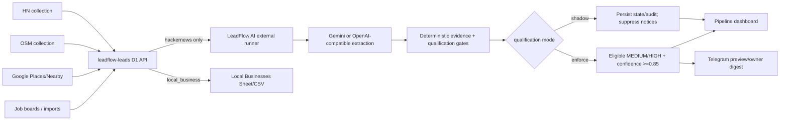

# LeadFlow AI and leadflow-leads: End-to-End Workflow

## System overview

There are two independent lead pipelines:

1. **Freelance buyer discovery:** HN/buyer threads are normalized and qualified. Only eligible `MEDIUM`/`HIGH` records can create approval alerts in enforce mode.
2. **Local-business cold outreach:** OSM and compatible local-business sources feed a manual calling/email queue. These records never enter the freelance Engine or Telegram/email approval route.

`leadflow-leads` owns upstream collection, normalization, D1 persistence and manual CSV export. `leadflow-ai` owns provider extraction, Stage C qualification, routing, shadow/enforce notification policy, dashboard state and manual local-business Sheet synchronization.



## Happy path

```mermaid
sequenceDiagram
  actor Scheduler
  participant Upstream as leadflow-leads
  participant Runner as external-pipeline
  participant Provider as Gemini/OpenAI
  participant Engine
  participant Dashboard
  participant Telegram

  Scheduler->>Upstream: POST /collect/hackernews
  Upstream-->>Scheduler: normalized HN leads
  Scheduler->>Runner: npm run external:run
  Runner->>Upstream: GET /leads?source=hackernews&sort=found_at&order=desc
  Upstream-->>Runner: newest-first bounded page
  Runner->>Upstream: GET original HN item/thread
  Upstream-->>Runner: evidence already upstream-provided
  Runner->>Provider: optional discovery extraction
  Provider-->>Runner: validated discoverySignals or warning
  Runner->>Engine: prefilter, rule evidence, Stage C qualification
  Engine-->>Runner: result, audit, score, rejection/missing fields
  Runner->>Runner: persist state and dashboard view
  alt shadow
    Runner-->>Dashboard: persist; no discovery notification
  else enforce
    Runner->>Runner: eligible MEDIUM/HIGH + confidence >=0.85 gate
    Runner->>Telegram: eligible notice/digest
  end
```

```text
LeadFlow upstream
  POST /collect/hackernews
  -> newest HN API page
  -> leadflow-ai GET /leads
  -> official HN item/thread evidence
  -> provider extraction (optional)
  -> deterministic hard gates + rule evidence
  -> qualification/audit persistence
  -> shadow: no notification
     enforce: eligible medium/high + confidence >=0.85 only
  -> dashboard + controlled notification
```

## Stage I/O contracts

### Configuration inputs

Local runner variables include:

- `EXTERNAL_LEADS_ENABLED`
- `EXTERNAL_LEADS_API_ORIGIN`
- `EXTERNAL_LEADS_API_TOKEN`
- `EXTERNAL_LEADS_SOURCES`
- `EXTERNAL_LEADS_BATCH_SIZE`
- `FREELANCE_QUALIFICATION_MODE=shadow|enforce`
- `AI_PROVIDER=gemini|openai`
- provider credentials, model and data-use flags
- `TELEGRAM_ENABLED`
- `SAFE_OWNER_EMAIL_TEST`

Requalification flags are `--requalify-missing` and `--requalify-all`. They suppress notifications.

### Upstream request

The runner requests:

```text
GET /leads?source=hackernews&sort=found_at&order=desc&limit=<1..5>&offset=<cursor>
Authorization: Bearer <token>
```

For HN records, the runner separately reads the Firebase item and, when available, its parent thread. It does not trust upstream producer score, status or contact fields.

### Candidate and discovery context

The adapter maps upstream rows into `LeadInput` plus `discovery_context`:

- source/provider and record ID
- original HN URL, item type, author, parent/thread IDs
- original title, raw text, decoded text
- timestamps, tags, links
- source hash and complete/truncated flags
- contact permission remains `UNKNOWN`
- contact email remains empty

Non-HN summaries are incomplete evidence and are not presented as a freelance brief.

### Provider extraction

Gemini or OpenAI-compatible discovery extraction receives source-grounded title/body context and a constrained JSON contract.

Validated `discoverySignals` include direction, employment/seller signals, independent project evidence, buyer role, scope, payment, location and confidence fields where supported. Every quote is checked against source text.

Provider cache keys include source hash and qualification schema/rule/prompt/capability/policy versions. The provider can add evidence; it cannot override deterministic exclusions.

### Qualification output

Stage C writes:

- final eligibility state: `ELIGIBLE`, `REJECTED`, `REVIEW_INCOMPLETE`, `QUARANTINED`, or `NEEDS_REQUALIFICATION`
- priority: `LOW`, `MEDIUM`, `HIGH`, or unprioritized review states
- `is_valid_freelance_lead`
- quality and confidence scores
- all rejection reasons and missing fields
- evidence quotes and score breakdown
- source hash
- method and classification timestamp
- schema/rules/prompt/capability/policy versions
- internal audit envelope and warnings

Deterministic hard exclusions remain authoritative over model signals.

### Shadow/enforce routing

| Mode | Qualification | Notification |
|---|---|---|
| shadow | Persist and display | Discovery Telegram/email suppressed |
| enforce | Persist and display | Only eligible MEDIUM/HIGH with confidence >=0.85 |

Legacy records have no synthesized validity and remain `NEEDS_REQUALIFICATION`. Rejected, incomplete, quarantined and low records never notify.

### State and dashboard

The external runner writes ignored state files under `data/external-*.json`:

- `external-gemini.json`
- `external-openai.json`
- `external-pipeline.json`
- `external-preview.json`

The dashboard selects the relevant latest local state and separates raw candidates, eligible, low, rejected, incomplete, quarantined and needs-requalification. It shows provider attribution/method and source-grounded evidence.

### Sheet synchronization

`local_business` records are pulled separately into the dedicated `Local Businesses` tab. The pull excludes Google Places/Nearby and is manually triggered.

I/O for sync:

```text
GET /leads?category=local_business&exclude_source=google_places,google_nearby&sort=score&order=desc&limit=200&offset=0
```

The row payload includes source identity, name/title/location/contact/website/PageSpeed/score/signal and campaign status/notes. A selected-row follow-up pushes only status/notes back to D1 after a non-Google `local_business` GET check.

No local-business row creates an approval request or Telegram/Gmail notification.

### OSM collection and outreach drafts

The leadflow-leads daily cron (01:30 UTC) collects up to three `DAILY_OSM` tags in `DEFAULT_CITY` after the keyless feeds. Tags run one after another against Overpass, with mirror fallback. Rows land in D1 as `local_business`. The owner previews first-contact emails with `npm run local:drafts -- --from-api` (`packages/core/local-business-email.ts`). Every send remains a manual, one-at-a-time owner action.

```text
cron -> DAILY_OSM tags -> Overpass (mirrors) -> D1 local_business
     -> Local Businesses Sheet / CSV           (manual research queue)
     -> npm run local:drafts                   (plain + HTML draft, animated logo)
     -> owner verifies business and contact    -> owner sends manually
```

## Diagram: notification and local-outreach split

```text
                         +----------------------+
                         | leadflow-leads D1    |
                         +----------+-----------+
                                    |
                  +-----------------+-----------------+
                  |                                   |
                  v                                   v
        freelance_request HN                 local_business
                  |                                   |
                  v                                   v
        Stage C qualification                 manual CSV / Sheet
                  |                                   |
       +----------+-----------+                       |
       |          |          |                       v
    rejected   incomplete  eligible             phone/email
       |          |          |                       research
       +----------+          v
                         shadow: persist only
                         enforce: MEDIUM/HIGH,
                         confidence >= 0.85
                              |
                              v
                        Telegram/email
                        approval only
```

## Provider and operational limits

- Gemini 503/transport/quota/schema failures safely fall back to deterministic rules.
- OpenAI-compatible support is discovery-only and was mocked/locally verified, not live-verified unless a live provider run is separately recorded.
- Current upstream HN freelancer runs may safely yield zero while only seller posts exist.
- Duplicate reuse does not requalify by default.
- Requalification never notifies.
- The Apps Script bundle is not assumed deployed until the remote project is separately verified.
- A loopback upstream API is unreachable from Google Apps Script; use a reachable HTTPS Worker and private bearer token.
